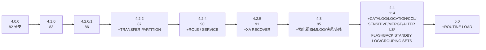

# ob-sql-parser

OceanBase 4.x（MySQL 模式）SQL Parser —— 纯 Go 实现。

解析引擎用 **goyacc 移植官方 Bison 文法**（`sql_parser_mysql_mode.y`），词法、AST、
Visitor、Formatter、JSON 与版本门控为自主设计。输出类型化 AST，可规范重建为 SQL
文本（round-trip）、可遍历、可 JSON 双向序列化、带**语句级与表达式级源码 Span**，
并原生支持**按 OceanBase 版本做特性门控**（`WithVersion("4.2.5")` 即严格限定到
4.2.5 的语法面）。

## 特性

- 纯 Go，运行期零外部依赖；goyacc 生成代码随源码入库，`go generate` 一键复现。
- 分层表达式文法（非 `%left` 优先级声明），语义动作只构造 AST，稳定可控。
- **源码位置**：goyacc 无 `%locations`，由 `gparser/genpos.go` 在 `go generate` 时
  注入 LALR 位置栈，为每个归约节点（含所有表达式）标注精确 `[Start,End)`。
- **版本门控**：特性标签 + 版本区间。已接入（版本以官方各 tag 文法校准）：
  `WITH … SELECT`(4.0+)、窗口 `ROWS/RANGE` 帧(4.0+)、`EXPLAIN EXTENDED`(4.1–4.3)、
  命名 `WINDOW`(4.2+)、`TRANSFER PARTITION`(4.2.2+)、ROLE/SERVICE(4.2.4+)、
  `XA RECOVER`(4.2.5+)、物化视图/MLOG/租户快照/克隆(4.3+)、CATALOG/LOCATION/CCL/
  SENSITIVE/MERGE/ALTER LS/FLASHBACK STANDBY LOG/`GROUPING SETS`/`EXCHANGE … VALIDATION`(4.4+)、
  ROUTINE LOAD(5.0+)。
- `formatter.Format` 规范重建 SQL，`parse -> format -> parse` 幂等（硬门槛）；
  `formatter.FormatWith(n, Options{Pretty:true})` 输出多行缩进（仅插入空白，可再解析）。
- `visitor.Walk` 通用遍历；`json.Marshal/Unmarshal/Dump` 双向（kind 判别符 + 反射解码）。

## 文档索引

| 文档                                                 | 回答什么                                        | 读者                      |
| ---                                                  | ---                                             | ---                       |
| [docs/usage.md](docs/usage.md)                       | 怎么用：API / 版本门控 / 错误模型 / 示例 / FAQ  | 集成方                    |
| [docs/coverage.md](docs/coverage.md)                 | 能解析什么：按能力形态的覆盖矩阵（活文档）      | 能力评估 / 语法选型       |
| [docs/version-coverage.md](docs/version-coverage.md) | 某语法从哪版可用：逐版本 diff 与 feature 校准   | 需精确 `WithVersion` 语义 |
| [docs/testing.md](docs/testing.md)                   | 怎么保证对：测试体系 / 新增流程 / 质量基线 / CI | 维护者 / 贡献者           |
| [docs/design.md](docs/design.md)                     | 为什么这样设计：架构 / 取舍 / 门控机制          | 深度读者                  |

## 安装

```bash
go get github.com/zetatez/ob-sql-parser
```

## 快速上手

```go
package main

import (
	"fmt"

	obparser "github.com/zetatez/ob-sql-parser"
	"github.com/zetatez/ob-sql-parser/ast"
	jsonpkg "github.com/zetatez/ob-sql-parser/json"
	"github.com/zetatez/ob-sql-parser/version"
	"github.com/zetatez/ob-sql-parser/visitor"
)

func main() {
	st, err := obparser.Parse("SELECT a, b FROM t WHERE a > 1")
	if err != nil {
		panic(err)
	}
	fmt.Println(obparser.Format(st)) // SELECT a, b FROM t WHERE a > 1

	// 源码位置：语句级 + 表达式级 Span
	fmt.Println(st.Span()) // 1:1 - 1:36

	// 版本门控：WITH ... SELECT 从 4.0 起可用
	if _, err := obparser.Parse(
		"WITH cte AS (SELECT 1) SELECT * FROM cte",
		obparser.WithVersion(version.MustParse("3.9.0")),
	); err != nil {
		fmt.Println("rejected:", err) // rejected: 1:1: ...
	}

	// 遍历：收集所有表名
	visitor.Walk(st, visitor.FuncVisitor(func(n ast.Node) visitor.Visitor {
		if ref, ok := n.(*ast.TableRef); ok && ref.RefKind == ast.RefTable {
			fmt.Println("table:", ref.Name.Parts[0]) // table: t
		}
		return visitor.NoOpVisitor{}
	}))

	// JSON 双向
	data, _ := jsonpkg.Marshal(st)
	back, _ := jsonpkg.Unmarshal(data)
	fmt.Println(obparser.Format(back))
}
```

多语句：

```go
stmts, err := obparser.ParseMulti("SELECT 1; SELECT 2; INSERT INTO t VALUES (3);")
```

## 版本适配矩阵



（数字 = 官方文法该版 `stmt:` 分支数）

- 官方 4.2.5 文法的 **91 个 `stmt:` 分支全部实现**；5.x 相对 4.2.5 新增的 26 个也全实现并门控。
- `WithVersion("4.2.5")` 拒绝 4.2.5 之后才有的语法；`WithVersion("4.2.2")` 拒绝 4.2.4+/4.3+…。
- 逐版本核对数据见 `docs/version-coverage.md`；门控由 `TestFeatureGating` /
  `TestVersionCorpus` 锁定。

## 覆盖范围（概览）

> 完整能力矩阵（按形态、含门控标注与示例 SQL）见 **[docs/coverage.md](docs/coverage.md)**。
> 以下仅为目录级速览。

- **查询**：SELECT（子查询、JOIN 全家、索引提示、GROUP BY [WITH ROLLUP]/
  GROUPING SETS/CUBE/ROLLUP、HAVING、QUALIFY、ORDER BY + NULLS、LIMIT、集合运算、
  WITH CTE、窗口函数含帧、FOR UPDATE NOWAIT/SKIP LOCKED、LOCK IN SHARE MODE、
  LATERAL、PROCEDURE ANALYSE、INTO OUTFILE/DUMPFILE/@变量）。
- **表达式**：全套算术/位/移位/比较/逻辑、`DIV/MOD`、`\|\|/&&`、`RLIKE/SOUNDS LIKE`、
  `COLLATE`、`IN/BETWEEN/LIKE…ESCAPE/IS`、`MEMBER OF`、`MATCH…AGAINST`、`CAST`/
  `CONVERT`、`CASE`、`INTERVAL`、`EXISTS`/标量子查询、`VALUES()`。
- **DML**：INSERT/REPLACE（多行 VALUES、SET、SELECT 源、ON DUPLICATE KEY UPDATE、
  RETURNING）、UPDATE、DELETE、MERGE。
- **DDL**：CREATE TABLE（列定义、约束、表选项、分区/子分区/自动分区、生成列、
  CTAS、LIKE）、CREATE/ALTER/DROP VIEW、SEQUENCE、DATABASE、INDEX、OUTLINE、
  物化视图/MLOG、TABLESPACE、TABLEGROUP、TENANT/RESOURCE（含 STANDBY/SWITCHOVER/
  RECOVER/CLONE/SNAPSHOT/RESTORE POINT）、DBLINK、LOCATION/CATALOG；
  ALTER TABLE 分区操作与列细节；DROP/TRUNCATE。
- **权限/账号**：GRANT/REVOKE、CREATE/DROP USER/ROLE、SET ROLE/PASSWORD、RENAME/LOCK USER。
- **事务/锁**：BEGIN/START TRANSACTION/COMMIT/ROLLBACK、SET TRANSACTION、SAVEPOINT 族、
  LOCK/UNLOCK TABLES、XA（全动作）。
- **会话/运维**：SHOW（TABLES/COLUMNS/INDEX/STATUS/ENGINE/FUNCTION·PROCEDURE STATUS/
  EVENTS/PROFILE(S)/GRANTS FOR/CREATE TABLE·VIEW·USER…等，含 LIKE/WHERE/FROM）、
  SET（变量/NAMES/CHARACTER SET/TRANSACTION）、USE、EXPLAIN（EXTENDED/PRETTY/
  FORMAT=/ANALYZE/FOR CONNECTION）、DESCRIBE、KILL、HELP、DO、ANALYZE/OPTIMIZE/REPAIR、
  LOAD DATA（含 `/*+ DIRECT */`）、FLUSH、PURGE、FLASHBACK、AUDIT、DUMP、SERVICE、
  ROUTINE LOAD、CCL/SENSITIVE RULE、OUTLINE、ROTATE MASTER KEY、TRANSFER PARTITION。
- **PL**：CREATE [OR REPLACE] PROCEDURE/FUNCTION（BEGIN…END 复合块：DECLARE 变量/
  游标/CONDITION、SET、IF/ELSEIF、WHILE/REPEAT/LOOP、CASE 语句、RETURN、标签
  label:/LEAVE/ITERATE、DECLARE…HANDLER、SIGNAL/GET DIAGNOSTICS、嵌套块、体内任意 SQL）、
  DROP ROUTINE、CALL。

## 目录结构

```
parse.go       顶层 API：Parse / ParseMulti / Format / MustParse（默认走 gparser）
version/       OceanBase 版本模型
feature/       特性标签 + 版本区间门控
token/         记号、关键字表
lexer/         手写词法器
ast/           节点模型 + Span + Finalize
gparser/       goyacc 解析器（主引擎）
  sql.y          文法（移植官方 .y）
  doc.go         //go:generate 入口 + 包文档
  genpos.go      go generate 后处理：注入位置栈（表达式级 Span）
  sql.go         生成结果（入库）
  adapter.go     obLexer：token 流 -> 终结符 适配（含上下文关键字）
  helpers.go     语义动作辅助与 AST 构造
  parse.go       驱动：整体一次解析，';' 由文法消费（支撑 PL 体内分号）
visitor/       遍历框架
formatter/     AST -> SQL（compact + pretty）
json/          AST 与 JSON（Marshal/Unmarshal/Dump）
docs/          设计/覆盖/版本/使用/测试全套文档
```

## 重新生成解析器

```bash
cd gparser && go generate   # 运行 goyacc 并注入位置栈（genpos.go）
```

需要先安装 goyacc：

```bash
go install golang.org/x/tools/cmd/goyacc@latest
```

> 注意：直接用 `goyacc -o sql.go sql.y` 重建会**丢失位置栈注入**；请始终用 `go generate`。

## 测试

```bash
go test ./...        # 常规
go test -race ./...  # 竞态（解析器实例无共享可变状态）
```

- round-trip：`gparser/gparser_test.go`、`parse_test.go`
- 官方 4.2.5 语料（82 分支 parse+round-trip+JSON 三重）：`gparser/corpus_test.go`
- 版本门控 / 严格 4.2.5：`gparser/version_corpus_test.go`、`integration_test.go`
- 覆盖矩阵（支持面活文档）：`gparser/coverage_test.go`
- 表达式级 Span：`gparser/span_test.go`；Pretty：`gparser/pretty_test.go`

## 已知边界

- 用户名/主机支持带引号形式（`'u'@'%'`、`'u'@'localhost'`）；全裸写 `u@localhost`
  暂不支持（与 `@` 变量词法冲突）。
- 部分 MySQL 兼容语法为**超集**（OB 各版文法均无）：`QUALIFY`、`PROCEDURE ANALYSE`、
  `MEMBER OF`、`LOCK IN SHARE MODE`、`GENERATED ALWAYS` 等。
- 未实现：`MOCK`（OB 内部测试专用语法）；SHOW 的无穷子参数（按需扩展）。
- 残留 24 处 shift/reduce 冲突均为官方文法固有（`NOT/ON/USING/COLLATE/DECLARE` 等），
  默认"移进优先"即期望语义，已由大量 round-trip/语料用例覆盖。

文档导航：

- [docs/usage.md](docs/usage.md) —— API 使用参考（示例 / 错误模型 / FAQ）
- [docs/coverage.md](docs/coverage.md) —— 语法覆盖矩阵（能力形态）
- [docs/version-coverage.md](docs/version-coverage.md) —— 逐版本语法覆盖与 feature 版本校准
- [docs/testing.md](docs/testing.md) —— 测试指南（体系 / 新增流程 / 质量基线 / CI）
- [docs/design.md](docs/design.md) —— 架构设计（含实现偏差记录）

## License

见 [LICENSE](LICENSE)。
