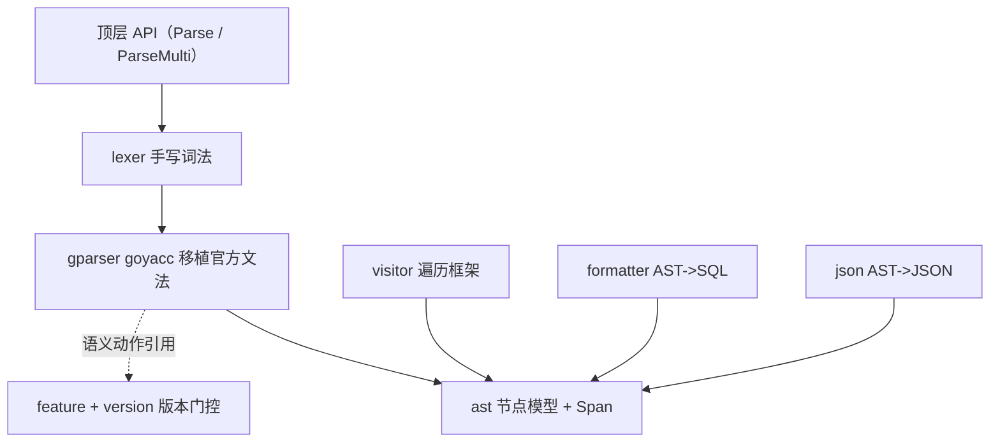
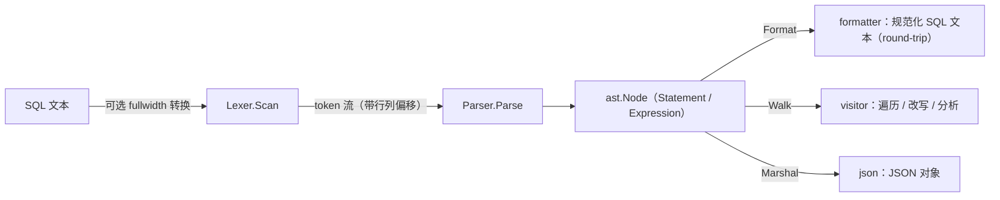
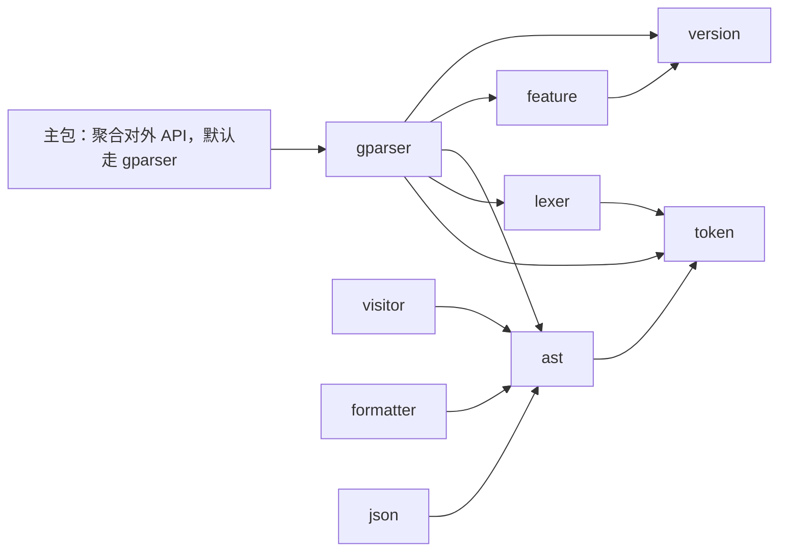

# ob-sql-parser 设计文档

OceanBase 4.x（MySQL 模式）SQL Parser —— Go 语言实现

作者：马天弋
状态：已实现（语句级 4.2.5 全量 + 5.x 增量 + PL + 多版本门控，`go test ./...` 全绿）

> 本文是最初的设计稿；实现过程中有若干偏离（见文末"实现偏差记录"）。
> 以 [README](../README.md) 与 [usage](usage.md) 为现状入口。

---

## 1. 背景与目标

### 1.1 为什么需要一个 Go 版的 OB MySQL 模式 parser

OceanBase 4.x 的 MySQL 模式（`compatibility mode = mysql`）在 SQL 语法上与
MySQL 高度兼容，但**不等价**：它引入了大量 OB 特有的语法扩展（分区、表组、
旁路导入、`alter system`、租户/集群管理、隐式游标、hint 语法、`auto` 分区等），
并且这些扩展随 4.0 -> 4.1 -> 4.2 -> 4.3 -> 4.4 逐版本演进。

生态中现有的 Go MySQL parser（如 `pingcap/parser`、`vitess.io/vitess`）面向的
是 MySQL 语义，无法解析/理解 OB 特有的语法；而官方只提供了 C++（Bison）解析器
与一个 Java（ANTLR）解析器，没有 Go 版本。因此在 Go 生态中：

- 需要离线**解析**与**校验** OB SQL；
- 需要基于 AST 做**改写 / 格式化 / 血缘分析 / 脱敏 / lint**；
- 需要以**代码**精确表达"某个语法特性在某版本可用/不可用"。

本项目的目标就是提供一个**纯 Go、无外部运行时依赖**的 OB 4.x MySQL 模式 SQL
parser：词法器手写，解析器用 **goyacc 移植官方 `.y` 文法**（生成代码随源码入库，
编译期即定型，运行期零依赖），并原生支持**多版本特性门控**。

### 1.2 目标与非目标

| 目标                                            | 非目标                                  |
| ---                                             | ---                                     |
| 手写词法器 + goyacc 移植官方文法（LALR(1)）     | 不用 ANTLR / 不引入运行期生成器依赖     |
| 输出带源码位置信息的类型化 AST                  | 不绑定任何 OB 服务端、不做执行计划优化  |
| AST 可还原为 SQL 文本（round-trip）             | 不做 Oracle（oboracle）模式             |
| 内置 Visitor 遍历框架                           | 不做执行计划优化                        |
| 内置 JSON 序列化                                | 不引入外部 parser 运行时                |
| **特性标签 + 版本区间** 的多版本门控            |                                         |

> 现状注记：语句面已远超"首期"范围——官方 4.2.5 的 **91 个 `stmt:` 分支全部实现**，
> 5.x 相对新增的 **26 个分支全实现并门控**，含 PL（BEGIN…END 复合块）与 JSON 双向。

> 解析引擎采用 goyacc，但**词法、AST、Visitor、Formatter、版本门控仍为手写/自主设计**，
> 与官方 C++ Bison 文法保持结构上的一一对应，便于后续跟随 OB 版本同步扩展。

## 2. 参考对象与本项目路线的取舍

### 2.1 官方参考

 | 参考                  | 位置                                                                   | 我们借鉴的点                                                                                                                                                                                             |
 | ---                   | ---                                                                    | ---                                                                                                                                                                                                      |
 | OB C++ MySQL 模式文法 | `oceanbase/src/sql/parser/sql_parser_mysql_mode.y`                     | 认可度最高的语法事实来源；表达式优先级、关键字（保留/非保留）分类、语句划分                                                                                                                              |
 | OB Java 解析器        | Maven `com.oceanbase:ob-sql-parser`（`com.oceanbase.tools.sqlparser`） | 面向工具的 AST 建模思想：`statement/{select,insert,update,delete,alter/table,...}`、`expression`、`adapter` 工厂分层；`MySQL*Factory` 与 `Oracle*Factory` 清晰展示模式差异如何注入 |
 | MySQL 官方文法/优先级 | MySQL 8 server 及社区 parser                                           | 通用表达式优先级与字面量词法                                                                                                                                                                             |

> 参考数据为同级 checkout 的官方 `sql_parser_mysql_mode.y`（v4.0.0_CE … v4.4.2_CE，
> 逐 tag 审阅，见 [version-coverage](version-coverage.md)）。

### 2.2 为什么最终选择 goyacc 移植官方文法

| 路线                 | 优点                                                                           | 缺点                                                                              | 结论          |
| ---                  | ---                                                                            | ---                                                                               | ---           |
| goyacc 移植官方 `.y` | 与 C++ 文法一致；覆盖面与后续同步有据可依；LALR(1) 表驱动、性能稳定             | 文法冲突需重排；Go yacc 无 `%locations`，需自行补位置；生成代码较大               | 采用 |
| 手写递归下降 + Pratt | 纯 Go、报错精细；AST 形态完全由库设计主导；版本门控自然                         | 覆盖 30k 行文法工作量大，易与官方文法漂移                                         | 曾实现，已移除（`gparser` 为唯一引擎，见文末"实现偏差记录"） |

实践中的取舍：

- **词法不生成**：官方 `.y` 依赖 Flex；我们用现有手写 `lexer` 产出 token 流，再适配
  给 goyacc（`gparser/adapter.go` 的 `obLexer`）。
- **AST 不生成**：所有语义动作只构造已有的 `ast` 节点，Parser 可替换而 AST 稳定。
- **版本门控放语义动作**：在动作里调用 `gateWith` 等，按 `feature` 区间判定，不满足时
  `panic(bailout)`，由驱动 `recover` 成带 `line:col` 的错误，避免污染 LALR 表。
- **非保留字当标识符**：只把文法中用到的关键字映射为终结符，其余词一律 `NAME_OB`，
  以支持 OB 大量非保留关键字充当列名/表名/别名。

> 手写 `parser/` 包曾作为行为对照与回归基准；`gparser` 覆盖面对齐后已删除
> （唯一引擎），见文末"实现偏差记录"。

## 3. 总体架构

### 3.1 模块划分



- lexer 生产 token 流；gparser 消费 token 产出 AST，语义动作层做版本门控。
- visitor / formatter / json 只读消费 AST，不反向依赖 gparser；版本门控只发生在
  gparser 语义动作层，LALR 表保持稳定。

### 3.2 数据流



### 3.3 依赖方向（无环）



## 4. 词法设计（lexer / token）

### 4.1 记号分类

`token/type.go` 定义记号编号（`TokenType`），分类如下：

 | 类别        | 记号                                          | 说明                                                                   |
 | ---         | ---                                           | ---                                                                    |
 | 边界        | `EOF`, `ILLEGAL`, `COMMENT`                   | COMMENT 保留原文供 formatter 还原                                      |
 | 标识符      | `IDENT`                                       | 裸标识符；`\`` 反引号引用；`"` 双引号引用（按模式/`ANSI_QUOTES` 处理） |
 | 字符串      | `STRING`, `HEXSTRING`, `BITSTRING`            | 携带 `_charset` introducer 信息                                        |
 | 数值        | `INT`, `DECIMAL`, `FLOAT`, `HEXNUM`, `BITNUM` | `0x…`、`0b…`、`1e5`、`1.2`                                             |
 | 占位        | `QUESTION`                                    | `?` prepared 参数占位                                                  |
 | 变量        | `VARIABLE`, `SYSVARIABLE`                     | `@x` / `@@session.x` / `@@global.x`                                    |
 | 操作符/标点 | `+ - * / % , . ; ( ) < > = ! &| ^ ~` 及组合 `<> <= >= != ...` | 按最长匹配                                             |
 | 命名操作符  | `AND OR NOT XOR IS LIKE IN REGEXP ...`        | 作为 `IDENT` 词法，由 parser 按上下文解释；关键字表负责分类            |

### 4.2 关键字处理：保留 vs 非保留

借鉴 OB `non_reserved_keywords_mysql_mode.c` 的分类思想：

- **保留字（reserved）**：在标识符位置默认不可用（`Token.Reserved == true`）。
- **非保留字（non-reserved）**：既是关键字、又可在标识符位置使用（OB/MySQL 大量此类）。

实现上，每个关键字记录在 `token` 包的注册表中：

```go
type Keyword struct {
    Text     string   // 规范化（小写）文本
    Reserved bool     // 是否保留
}
var keywords = map[string]Keyword{ ... } // 大写法：SELECT SELECT 等
```

`IDENT` 记号在 lex 时会被回查 `LookupKeyword`，把 `Keyword` 与 `Reserved` 装入 `Token`，
但**词法阶段不区分关键字与标识符**——统一产出 `IDENT`，解释权交给 parser，从而天然支持
"非保留字当列名/表名/别名"。这是 MySQL 语法能写得"松散"的关键。

### 4.3 词法要点

- **字符器引入符（charset introducer）**：`_utf8mb4'abc'` 前缀识别，存入 token。
- **字符串转义**：单引号内 `''` 转义；`\` 转义序列（`\n \t \\ \0 \' \" \b \r \Z \u`）。
- **数字**：整数、小数、指数、十六进制 `0x`、二进制 `0b`、位串 `b'...'`/`x'...'`。
- **注释**：`#`、`-- `（需后跟空白）、`/* ... */`（含 `/*!版本` 可执行注释与 `/*+ hint */`）。
- **全角转换**：部分客户端会发全角标点，提供可选的 `Fullwidth(true)` 开关做宽度转换（对齐 OB `ob_parser_fullwidth_converter` 的定位）。
- **位置信息**：每个 token 记录 byte `Offset`、`Line`、`Col` 及结束位置，供 AST `Span` 使用。

## 5. AST 设计（ast 包）

### 5.1 统一节点接口

```go
type Node interface {
    NKind() NodeKind          // 节点类型标签（字符串），用于 Visitor / JSON 区分
    Span() token.Span         // 源码定位 [Start, End)
    Children() []Node         // 子节点列表，供通用遍历
}

type Statement Node   // 语句
type Expression Node  // 表达式
```

每个具体节点结构体内嵌不可导出的 `nodeBase`（保存 `kind` 与 `span`），并提供
构造辅助；所有字段是导出的，且带 `json` tag 以便 `encoding/json` 直接工作。

### 5.2 节点层次

```mermaid
flowchart TD
    N["Node"] --> ST["Statement"]
    N --> EX["Expression"]

    ST --> SEL["SelectStmt<br>（嵌套 SelectBody，UNION/EXCEPT/MINUS + INTERSECT）"]
    ST --> INS["InsertStmt<br>（INSERT / REPLACE，IGNORE、ON DUPLICATE KEY UPDATE）"]
    ST --> UPD["UpdateStmt"]
    ST --> DEL["DeleteStmt"]
    ST --> CT["CreateTableStmt / CreateTableLikeStmt"]
    ST --> CI["CreateIndexStmt"]
    ST --> DT["DropTableStmt / DropIndexStmt / DropViewStmt"]
    ST --> TRU["TruncateTableStmt"]
    ST --> SHW["ShowStmt<br>（SHOW TABLES / DATABASES / CREATE TABLE / VARIABLES ...）"]
    ST --> SET["SetStmt<br>（变量 / 会话 / 事务）"]
    ST --> USE["UseDbStmt / ExplainStmt"]
    ST --> BEG["BeginStmt / CommitStmt / RollbackStmt"]
    ST --> MORE["..."]

    EX --> LIT["Literal<br>（STRING/NUMBER/HEX/BIT/NULL/TRUE/FALSE）"]
    EX --> ID["Identifier<br>（a.b.c 分段，列/表/别名通用）"]
    EX --> STAR["StarLiteral（* 与 tbl.*）"]
    EX --> UN["UnaryExpr<br>（NOT, -, ~, BINARY, COLLATE, !）"]
    EX --> BIN["BinaryExpr<br>（=, <>, <, >, +, -, *, /, %, &, |, ^, <<, >>, AND, OR, DIV, MOD ...）"]
    EX --> FC["FuncCall<br>（普通/聚合/窗口函数：name + args + OVER）"]
    EX --> CAST["CastExpr（CAST / CONVERT）"]
    EX --> CASE["CaseExpr（CASE WHEN/ELSE）"]
    EX --> BINL["BetweenExpr / InExpr / LikeExpr / IsExpr"]
    EX --> IV["IntervalExpr"]
    EX --> SUB["ExistsExpr / SubqueryExpr（标量）"]
    EX --> PM["ParamMarker（?）"]
    EX --> VAR["Variable（@x / @@var）"]
    EX --> WIN["WindowExpr / WindowSpec（基础）"]
```



领域对象（关系、子句）：

```go
type TableRef       // 表/子查询/连接：name、alias、join、ON/USING
type SelectBody     // DISTINCT、投影、FROM、WHERE、GROUP BY、HAVING、ORDER BY、LIMIT、WINDOW、FOR UPDATE
type ColumnItem     // 投影项（expr + alias）
type OrderItem  // 排序项（expr + ASC/DESC + NULLS {FIRST,LAST}）
type TableOption / PartitionSpec / ColumnDef / IndexDef（CreateTable 相关基础）
```

### 5.3 源码位置

```go
// token 包
type Position struct { Offset, Line, Col int } // Col 为 1 基
type Span struct { Start, End Position }
```

`nodeBase` 保存该节点覆盖的 `Span`。派生节点（如通过合并构造的）Span 为 `[首个子节点.Start, 末个子节点.End)`。

### 5.4 JSON 序列化

- 利用 `encoding/json` 直接序列化导出字段 + `Kind` 字段，得到自描述 JSON。
- 反序列化（ast.Context）作为 v0.2 增强项（需在 `Kind` 基础上做类型分发），首版以
  `Marshal`（AST->JSON）为主，满足"序列化/调式/存储"需要。

## 6. 语法解析器（gparser 包，goyacc）

### 6.1 策略

- 文法文件 `gparser/sql.y` 用 **goyacc** 编译为 `gparser/sql.go`（`go generate` 触发），
  结构与官方 `sql_parser_mysql_mode.y` 对齐：语句级 + 分层表达式文法。
- **表达式不使用 `%left/%right` 优先级声明**，而是显式分层展开，保证语义动作可控、无
  歧义：
  `expr -> or_expr -> xor_expr -> and_expr -> not_expr -> bool_pri -> predicate ->
  bit_or -> bit_and -> shift_expr -> additive -> multiplicative -> power -> unary ->
  simple_expr`。
- **语句**：`stmt: stmt_inner`，`stmt_inner` 覆盖 SELECT / INSERT / UPDATE / DELETE /
  CREATE / DROP / TRUNCATE / SHOW / SET / USE / EXPLAIN / 事务 / DESCRIBE，逐条对应
  `.y` 中的分支。
- **词法适配**：`obLexer` 把已 lexed 的 token 流按需映射为终结符；`;` 视为语句边界
  （返回 0），驱动逐条解析，天然支持多语句。

### 6.2 语义动作与 AST

- 语义值统一为 `interface{}`（`%union { node interface{} }`），动作里只做节点构造
  （`bin(...)`、`newIdent(...)`、`&ast.SelectBody{...}` 等），AST 形态不依赖文法生成。
- `stmt` 归约时通过 `lset(yylex, …)` 把结果交给驱动；错误经 `yyLexer.Error` 记录
  `line:col`。

### 6.3 版本门控与冲突

- 门控放在语义动作里（如 `opt_with` 归约时调用 `gateWith(yylex)`），依据 `feature`
  区间判断；不满足则 `panic(bailout{err})`，由 `parseOne` 的 `recover` 转成普通错误。
  这样**版本相关逻辑不进入 LALR 表**，表保持稳定。
- 已接入的门控（默认未指定版本时全部放行）：
  - 4.0+：`FWithCte`（`WITH … SELECT`）、`FRowWindowFrame`（`ROWS/RANGE` 窗口帧）
  - 4.1 <= v < 4.3：`FExplainExtended`（`EXPLAIN EXTENDED`）
  - 4.2+：`FWithWindows`（命名 `WINDOW` 子句）
  - 4.3+（版本暂估，待官方核对）：`FMaterializedView`（物化视图/MLOG）、
    `FExternalCatalog`、`FExternalLocation`、`FRoutineLoad`、`FCCLRule`、
    `FTenantSnapshot`、`FCloneTenant`、`FAutoPartition`（`PARTITIONS AUTO`）
  - 4.4+：`FSensitiveRule`、`FAlterLS`（`ALTER SYSTEM … LS`）
  - 5.0+：`FFlashbackStandbyLog`
  - 未实现对应语法：`FJsonTableFunc`、`FColumnStoreIndex`
  - 由此 `WithVersion(version.MustParse("4.2.5"))` 可拒绝上述 4.2.5 之后才有的语法，
    达到"4.2.5 精确语法面"的严格适配（特性版本的后续校准只需改 `Since`）。
- 残留的 shift/reduce 冲突（约 23 处，0 处 reduce/reduce）集中在 `NOT`
  （`NOT LIKE/IN/BETWEEN`）、`ON/USING`（连接条件与别名）、`DECLARE`（游标声明二义）、
  `COLLATE`（后缀结合）等处，均为官方文法固有或需 2 个 lookahead 的形态；goyacc 默认
  "移进优先"即得到期望语义，已由大量 round-trip/健壮性用例覆盖。已通过词法上下文
  （ANALYZE 非保留化等）与文法去重（列属性冗余项、命名索引约束移出共享非终结符）
  将冲突从 26 收敛到 23。

### 6.4 语句覆盖（现状：4.2.5 全量 + 5.x 增量）

官方 v4.2.5 的 `stmt:` **91 个分支全部实现**；5.x 相对新增的 **26 个分支全实现并门控**
（catalog/location/ls/mlog/mview/ccl/sensitive/snapshot/clone/routine_load/merge/
flashback_standby 等）。以下为按能力类别的现状矩阵（支持=已实现，含子形态）。

| 类别     | 覆盖                                                                                                                         | 状态    |
| ---      | ---                                                                                                                          | ---     |
| 查询     | `SELECT`：子查询、JOIN（INNER/LEFT/RIGHT/FULL [OUTER]/CROSS/STRAIGHT/NATURAL）、索引提示、GROUP BY（含 `WITH ROLLUP`）、HAVING、ORDER BY + NULLS、LIMIT、集合运算 UNION/EXCEPT/INTERSECT/MINUS、WITH CTE、窗口函数（含 `ROWS/RANGE` 帧）、FOR UPDATE/SHARE | 支持/部分 |
| DML      | `INSERT`/`REPLACE`（多行 VALUES、SET、SELECT 源、ON DUPLICATE KEY UPDATE、RETURNING）、`UPDATE`、`DELETE`（WHERE/ORDER BY/LIMIT） | 支持/部分 |
| MERGE    | `MERGE INTO tgt USING src ON cond WHEN MATCHED THEN UPDATE SET …[DELETE WHERE …] / DELETE / WHEN NOT MATCHED THEN INSERT…VALUES…` | 支持      |
| 建表     | `CREATE TABLE`（列定义/类型参数/UNSIGNED/默认值/注释/生成列 `AS (expr) [VIRTUAL\|STORED]`、表级约束、表选项）、分区 `PARTITION BY RANGE/LIST/HASH/KEY [COLUMNS]` + `PARTITION p VALUES LESS THAN\|IN` + `SUBPARTITION BY HASH/KEY`、`CREATE TABLE ... AS SELECT`、`CREATE TABLE LIKE`、`CREATE [UNIQUE] INDEX`、`CREATE DATABASE` | 支持/部分 |
| 物化视图 | `CREATE MATERIALIZED VIEW … [REFRESH FAST\|COMPLETE\|FORCE] [ON DEMAND\|ON COMMIT] AS SELECT`、`DROP MATERIALIZED VIEW [IF EXISTS] …`                                     | 支持      |
| 集群管理 | `CREATE/DROP/ALTER TENANT`、`CREATE/DROP RESOURCE UNIT\|POOL`、`CREATE/DROP TABLEGROUP`、`CREATE/DROP TABLESPACE`（支持 `NAME=value` 与 `NAME=(list)` 选项） | 支持/部分 |
| 诊断     | `SIGNAL SQLSTATE … [SET …]`、`RESIGNAL …`、`GET [CURRENT\|STACKED] DIAGNOSTICS …`                                                                      | 支持      |
| 改表     | `ALTER TABLE`：`ADD/DROP/MODIFY/CHANGE COLUMN`、`ADD/DROP/RENAME INDEX`、`ADD [CONSTRAINT]`、`DROP PRIMARY KEY`、`RENAME [TO]`、`ALTER COLUMN SET/DROP DEFAULT`；`ALTER DATABASE/SCHEMA`；`ALTER SYSTEM SET name = value` | 支持/部分 |
| 视图     | `CREATE [OR REPLACE] VIEW [cols] AS SELECT`、`DROP VIEW [IF EXISTS] …`                                                        | 支持      |
| 序列     | `CREATE SEQUENCE [IF NOT EXISTS] …`（START WITH/INCREMENT BY/MINVALUE/MAXVALUE/CACHE/CYCLE/ORDER）、`DROP SEQUENCE [IF EXISTS] …` | 支持      |
| 权限     | `GRANT priv[,…] ON level TO 'u'@'h'[, …] [WITH GRANT OPTION]`、`REVOKE priv[,…] ON level FROM 'u'@'h'[, …]`（`priv` 支持列级 `(cols)` 与 `ALL [PRIVILEGES]`） | 支持/部分 |
| 账号     | `CREATE USER [IF NOT EXISTS] 'u'@'h'[,…] [IDENTIFIED BY 'pwd']`、`DROP USER [IF EXISTS] …`、`CREATE/DROP ROLE`、`SET ROLE {…\|NONE\|DEFAULT}`、`SET PASSWORD [FOR …] = …` | 支持/部分 |
| 会话/运维 | `KILL [CONNECTION\|QUERY] n`、`HELP expr`、`ANALYZE/OPTIMIZE/REPAIR TABLE …`、`RENAME TABLE a TO b[, …]`、`LOAD DATA [LOCAL] INFILE …`（FIELDS/LINES/IGNORE n LINES/列清单）、`FLUSH [LOCAL] TABLES\|PRIVILEGES\|STATUS …`、`PURGE TABLE\|INDEX\|RECYCLEBIN`、`FLASHBACK TABLE … TO BEFORE DROP\|TO SNAPSHOT …`、`SHOW GRANTS FOR …`、`SHOW CREATE USER …` | 支持/部分 |
| XA       | `XA {START\|BEGIN} xid [JOIN\|RESUME]`、`XA END xid [SUSPEND [FOR MIGRATE]]`、`XA PREPARE\|COMMIT [ONE PHASE]\|ROLLBACK xid`、`XA RECOVER [CONVERT XID]`（`xid` 支持 1–3 段） | 支持      |
| 预处理   | `PREPARE name FROM 'sql'|@var`、`EXECUTE name [USING @a, @b …]`、`DEALLOCATE PREPARE name`                                                     | 支持      |
| 删除     | `DROP TABLE`、`DROP INDEX`、`DROP DATABASE`、`TRUNCATE`                                                                      | 支持      |
| 其他     | `SHOW`（TABLES/DATABASES/SCHEMAS/VARIABLES/STATUS/CREATE TABLE\|DATABASE\|VIEW\|PROCEDURE\|FUNCTION\|TRIGGER/COLUMNS/FIELDS/INDEX/TABLE STATUS/TRIGGERS/CHARACTER SET/PRIVILEGES/PLUGINS/PROFILES/OPEN TABLES/WARNINGS/ERRORS/GRANTS/PROCESSLIST/COLLATION/ENGINES）、`SET`、`USE`、`EXPLAIN`、`DESCRIBE` | 支持/部分 |
| 事务/锁  | `BEGIN/START TRANSACTION/COMMIT/ROLLBACK`、`SET [GLOBAL\|SESSION] TRANSACTION …`、`SAVEPOINT`/`RELEASE SAVEPOINT`/`ROLLBACK TO SAVEPOINT`、`LOCK TABLES … READ\|WRITE`/`UNLOCK TABLES` | 支持 |
| 索引提示 | `USE/FORCE/IGNORE INDEX [FOR JOIN\|ORDER BY\|GROUP BY] (…)`                                                                  | 支持      |
| 表达式   | 全套算术/位/移位/比较/逻辑、`DIV`/`MOD`、`\|\|`/`&&`、`RLIKE`/`REGEXP`/`SOUNDS LIKE`、`COLLATE`、`IN`/`BETWEEN`/`LIKE … ESCAPE`/`IS [NOT] NULL\|TRUE\|FALSE`、`MEMBER OF`、`MATCH … AGAINST`、`CAST`、`CASE`、`INTERVAL`、`EXISTS`/标量子查询 | 支持      |
| 分组     | `GROUP BY` 支持普通表达式与 `GROUPING SETS`/`CUBE`/`ROLLUP`，`WITH ROLLUP`                                                       | 支持      |
| PL      | `CREATE [OR REPLACE] PROCEDURE\|FUNCTION`（参数/返回类型 + `BEGIN…END` 复合块：`DECLARE`/`SET`/`IF…ELSEIF…ELSE`/`WHILE`/`REPEAT…UNTIL`/`LOOP`/`RETURN`/游标/`SIGNAL`/**标签 `label: …` + `LEAVE`/`ITERATE`**/**`DECLARE … HANDLER`（CONTINUE/EXIT/UNDO，SQLSTATE/`NOT FOUND`/命名条件）**、可嵌套块、体内任意 SQL）、`DROP PROCEDURE\|FUNCTION`、`CALL` | 支持 |
| JSON     | `Marshal`（含 kind）、`Unmarshal`（kind 注册表 + 反射解码）、`Dump`（多语句列表）、`String/Write` | 支持 |
| 未实现   | `MOCK`（OB 内部测试专用集合语法，其构成语句已独立覆盖）等冷门尾项 | （未排期） 后续 |

未实现语法当前统一返回带 `line:col` 的语法错误（goyacc 路径没有独立的
`ErrUnsupported`），保证"明确失败"而非静默产生错误 AST。

## 7. 多版本 / 特性门控（feature + version）

### 7.1 版本模型

```go
// version 包
type Version struct { Major, Minor, Patch int; Suffix string } // 4.2.4_CE 等
func Parse(s string) (Version, error)   // "4.2.4" / "4.2.4.2" / "4.2"
func (v Version) Compare(o Version) int
```

OB 4.x 主版本区间：`4.0`, `4.1`, `4.2`, `4.3`, `4.4`。

### 7.2 特性标签与版本区间

每个语法特性被赋予一个稳定 `FeatureID`，并记录其**可用版本区间**：

```go
// feature 包
type FeatureID string
const (
    FWithWindows         FeatureID = "with_windows"      // 版本化窗口
    FRowWindowFrame      FeatureID = "row_window_frame"  // ROWS/RANGE 帧
    FAutoPartition       FeatureID = "auto_partition"
    FExplainExtended     FeatureID = "explain_extended" // 4.1–4.3 区间
    FTransferPartition   FeatureID = "transfer_partition"
    FMaterializedView    FeatureID = "materialized_view"
    ...
)

type Rule struct {
    Feature FeatureID
    Since   version.Version // 引入版本（含）
    Until   version.Version // 弃用版本（可选；空=仍支持）
    Desc    string
}
```

`feature.Registry` 缓存 `FeatureID -> Rule`，并提供：

```go
func (f *Registry) Enabled(feature FeatureID, v version.Version) bool
```

### 7.3 解析时的门控方式

```go
// gparser 语义动作中的门控示例（实际见 gparser/gate.go 的 gateFeat）
if feature.DefaultRegistry.Enabled(feature.FAutoPartition, targetVersion) {
    ... // 仅在此版本才能解析对应语法
}
```

默认（未指定版本）开启全部特性 -> 兼容"最新 OB"。指定版本则按区间裁剪。
已引入但**早于 Since** 或**晚于 Until** 的语法将被拒绝，并给出版本相关提示。

## 8. Visitor（visitor 包）

### 8.1 接口

```go
type Visitor interface {
    VisitNode(node ast.Node) Visitor  // 返回 nil 表示不再深入该子树
}
```

借助 `Children() []Node` 实现基础 Walk：

```go
func Walk(node ast.Node, v Visitor)
```

用户可通过返回子 `Visitor` 实现"带状态"的遍历。内置 `visitor.Stringer`/分析辅助在后续补充。

- 该设计让"改写器"（如给 SELECT 追加 FORCE INDEX / 脱敏）自然实现：替换子节点后把新节点交给上层。

## 9. Formatter（formatter 包）：AST -> SQL

### 9.1 目标

- 把类型化 AST 还原为**语法正确、可再解析**的 SQL 文本（round-trip 是解析正确性的强验证）。
- 提供两种风格：`Default`（相对紧凑，保留语义）与 `Compact`/`Pretty`（后续）。
- 关键字大小写、别名 `AS` 有无、空格、`JOIN`/逗号连接，均有稳定的策略并在文档中说明。

### 9.2 实现

- 内部为一个 `Formatter` 类型，持有 `strings.Builder` 与缩进状态，按节点 `NKind()` 分支输出。
- 字符串字面量按词法准则加引号并转义；标识符按"是否需要反引号"决定是否加 `\``（保留字或含特殊字符时必加）。
- 与词的 `Span` 无关，输出是**规范重建**而非原文切片，保证可移植、稳定。

### 9.3 Round-trip 测试

`golden` 测试：`parse(sql) -> format -> parse(format) -> 两个 AST 归一化后相等`。
归一化通过 `Normalize`（比较结构化字段而非文本）。

## 10. JSON（json 包）：AST -> JSON

- `json.Marshal(node)`：导出 `Kind` + 各字段，采用 `encoding/json`。
- 提供 `json.Format(node)` 返回带缩进的文本便于调试。
- 对包含 `Expression`/`Statement` 接口字段的节点，直接序列化其具体指针值（Go 可序列化接口内存的具体值），天然可读。

## 11. 错误模型

统一错误类型：

```go
type Error struct {
    Position  token.Position  // 出错处
    Line, Col int
    Msg       string
    // Cause 可能有：ErrSyntax（语法）、ErrUnsupported（特性未实现）、ErrVersion（版本门控拒绝）
}
```

字符/词法错误在 lex 阶段即产出；语法与版本错误在 parse 阶段产出。goyacc 路径下由
`gparser.Error{Line, Col, Msg}`（`Error()` 输出 `line:col: message`）承载，也可被
CLI/IDE 直接消费。

位置填充：goyacc 无 `%locations`。实现方式：
- **语句级**：`lset` 依据语句首/末 token 回填；
- **表达式级（全树）**：`gparser/genpos.go` 在 `go generate` 时先跑 goyacc，再对生成的
  LALR 归约循环注入并行"起始 token 索引栈"（`yyPos`/`yyTok`），每次归约在 `reduceSpan`
  中把节点标注为其创建规则的精确 `[Start,End)`；父规则复用子指针时"首标固定"不覆盖。
  此方案不改动任何语义动作，且 `go generate` 可复现（重新生成无 diff）。

## 12. 目录结构（建议）

```
ob-sql-parser/
  go.mod                 # module github.com/zetatez/ob-sql-parser
  README.md              # 快速上手 + 文档导航
  parse.go               # 顶层 API：Parse / ParseMulti（主包）
  integration_test.go    # 顶层集成测试（版本门控 / visitor / JSON）
  version/               # OceanBase 版本模型
  feature/               # 特性标签 + 版本区间门控
  token/                 # 记号、关键字表（token.go + keywords.go）
  lexer/                 # 手写词法器（lexer.go + literal.go）
  ast/                   # 节点模型 + Span + Finalize（按域拆分：expr/select/dml/ddl/stmt）
  gparser/               # goyacc 解析器（主引擎）
    sql.y              # 文法（移植官方 .y）
    sql.go             # go generate 生成的 LALR 表 + 动作
    doc.go             # //go:generate 入口 + 包文档
    genpos.go          # 后处理：注入表达式级 Span 位置栈
    adapter.go         # obLexer：token 流 -> 终结符 的适配
    helpers.go         # 语义动作辅助与节点构造
    gate.go            # gateFeat / bailout / lset（版本门控与错误恢复）
    parse.go           # 驱动：逐语句解析 + bailout 恢复
  visitor/               # 遍历框架
  formatter/             # AST->SQL（按域拆分：stmt/select/dml/ddl/pl/show_set/expr）
  json/                  # AST->JSON
  docs/                  # design / coverage / version-coverage / usage / testing
```

## 13. 测试策略

| 层        | 测试                                  | 目的                             |
| ---       | ---                                   | ---                              |
| version   | `TestVersionParse/Compare`            | 版本解析与比较                   |
| feature   | `TestDefaultGating/TestCustomRegistry`| 区间门控正确性                   |
| lexer     | table-driven 词法采样                 | 记号类别、位置、转义、introducer |
| gparser   | `TestExtraRoundTrip`/`TestOfficialCorpus` | 语句面 + parse->format->parse 幂等 |
| formatter | 72 个精确输出断言 + 排版冒烟           | `parse->format->parse` 一致性      |
| json      | 45+ 语句 JSON 双向 + 错误路径          | AST->JSON 字段齐全                |
| 版本门控  | `TestVersionCorpus`/`TestFeatureGating` | 同一 SQL 在不同 OB 版本的接受/拒绝 |
| span      | `TestExpressionSpans`                 | 表达式级源码位置精确             |

详见 [testing](testing.md)。

## 14. 演进路线（Roadmap）

- **v0.1（已完成）**：词法 + AST + goyacc 移植官方文法 + 版本门控 + Visitor + Formatter + JSON。
- **v0.2（已完成）**：`ALTER TABLE/SYSTEM`、CREATE TABLE 分区/表选项、`MERGE`。
- **v0.3（已完成）**：视图、用户与权限（GRANT/REVOKE）、租户/资源/集群管理语句。
- **v0.4（已完成）**：存储过程/函数块（PL 全语法）、游标/处理器、JSON 反序列化。
- **v0.5（已完成，子集）**：多版本门控全面校准至 4.0–4.4/5.0（catalog/location/mview/…
  全部按官方 tag 门控）。
- **候选（未排期）**：Oracle 模式（`oboracle`，复用同一 AST/Visitor，解析/词法层做
  模式注入）；SHOW 无穷子参数；语句级错误恢复与更细诊断。

## 15. 一些已确认的设计取舍

1. **关键字词法不区分、语义区分**：lexer 一律产出 `IDENT`，由 gparser 的终结符映射/关键字表
   解释，从而支持 OB 大量非保留字作标识符。
2. **Span 为一等公民**：每个节点带 `[Start,End)`；goyacc 无 `%locations`，由
   `gparser/genpos.go` 在生成期注入位置栈，**语句级与表达式级**均已回填。
3. **解析引擎唯一**：goyacc（`gparser`）为唯一引擎；AST/Visitor/Formatter/门控与
   引擎解耦（词法/AST 均为自主实现）。
4. **版本门控放语义动作层**，而非文法/表结构，保证 LALR 表稳定、门控策略可替换。
5. **Round-trip 优先**：以 formatter 的「可再解析」作为正确性硬门槛。
6. **明确失败优于静默**：无法解析的输入返回带 `line:col` 的错误，绝不产生语义缺失的 AST。

## 16. 实现偏差记录（相对本文设计稿）

| 设计稿 | 实现 | 原因 |
| --- | --- | --- |
| 手写 `parser/` 保留作对照 | **已删除**（gparser 唯一引擎） | 双实现维护成本高，gparser 覆盖面对齐后无对照价值 |
| 表达式级 Span 列为"后续增强" | **已实现**（`genpos.go` 生成期注入位置栈） | 找到 LALR 栈注入方案，无运行期成本 |
| feature 命名 `F_*` | 改为驼峰 `FWithWindows` 等 | 与 Go 命名规范一致 |
| Roadmap v0.5 = Oracle 模式 | 改为多版本门控全面校准 | Oracle 模式未排期；门控是更高优先级差异化 |
