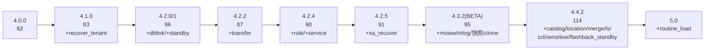

# OB 版本语法覆盖对照（version coverage）

> 本文回答"**某语法特性从哪个 OB 版本开始可用**"。它是 `feature/feature.go` 中
> 门控矩阵（`Since`）的事实依据，全部数字可由同级 checkout 的官方文法**重新生成**。
>
> 读者：需要精确 `WithVersion()` 语义的集成方 / 维护者。
> 相关文档：[coverage](coverage.md) 讲"能解析什么"；[design](design.md) 第 7 节 讲门控机制。

## 1. 方法论（可复现）

数据来源：本仓库同级目录 `../oceanbase`（OceanBase CE 源码）的官方文法
`src/sql/parser/sql_parser_mysql_mode.y`，逐 tag 比对。

已核对的 tag：`v4.0.0_CE`、`v4.1.0_CE`、`v4.2.0_CE`、`v4.2.1_CE`、`v4.2.2_CE`、
`v4.2.4_CE`、`v4.2.5_CE`、`v4.3.2_CE_BETA`、`v4.4.2_CE`。

**口径**：`stmt:` 规则中 `| xxx_stmt` 的计数（**首 token 计数**；部分行形如
`| alter_with_opt_hint SYSTEM …` 不进入 `xxx_stmt` 形态，因此数字是**下界**；
个别条目因"该分支在版本间被重构为经其他非终结符解析"而表现为增删，不代表真实移除）。

重新生成（含选项级 diff 表）：

```bash
cd ../oceanbase
for t in v4.2.5_CE v4.4.2_CE; do
  git show "$t:src/sql/parser/sql_parser_mysql_mode.y" > /tmp/425.y  # 注意 zsh 下变量后接冒号需引号 "${t}:..."
done
grep -c "PARTITIONS AUTO" /tmp/425.y        # 选项级出现次数（0/1/…）
```

> 坑：zsh 中 `$t:path` 会被当作参数修饰符，必须写 `"${t}:path"`。

## 2. 逐版本演进



（数字 = 该版 `stmt:` 分支数；5.0 未逐版核对分支数）

| 版本        | `stmt:` 分支数 | 相对上一版新增                                                            |
| ---         | ---            | ---                                                                       |
| 4.0.0       | 82             | — 基线                                                                    |
| 4.1.0       | 83             | `recover_tenant_stmt` 等                                                  |
| 4.2.0       | 86             | `create/drop_dblink_stmt`、`create_standby_tenant_stmt`                   |
| 4.2.1       | 86             | 无新增                                                                    |
| 4.2.2       | 87             | 门控 `transfer_partition_stmt`                                            |
| 4.2.4       | 90             | 门控 `create/drop/set_role_stmt`、`service_name_stmt`                     |
| 4.2.5       | 91             | 门控 `xa_recover_stmt`                                                    |
| 4.3.2(BETA) | 95             | 门控 mview/mlog/tenant_snapshot/clone 族                                  |
| 4.4.2       | 114            | 门控 catalog/location/merge/alter_ls/ccl/sensitive/flashback_standby 族等 |
| 5.0+         | —              | 门控 `routine_load_stmt`                                                  |

> "门控" 标注表示本项目对该能力做了 `Since` 版本门控（见第 3 节）。

## 3. feature `Since` 校准表（feature/feature.go）

| feature                                                                                                                                             | `Since` | 证据                                                    |
| ---                                                                                                                                                 | ---     | ---                                                     |
| `FWithCte`、`FRowWindowFrame`                                                                                                                       | 4.0.0   | 4.0.0 文法已有 WITH CTE / 窗口帧                        |
| `FExplainExtended`                                                                                                                                  | 4.1.0   | EXPLAIN EXTENDED 区间（4.1–4.3，`Until` 4.3.0）         |
| `FWithWindows`、`FJsonTableFunc`                                                                                                                    | 4.2.0   | 命名 WINDOW、JSON_TABLE                                 |
| `FTransferPartition`                                                                                                                                | 4.2.2   | 4.2.2 出现 transfer                                     |
| `FRoleManagement`、`FServiceName`                                                                                                                   | 4.2.4   | 4.2.4 出现 role/service                                 |
| `FXaRecover`                                                                                                                                        | 4.2.5   | 4.2.5 出现 xa_recover                                   |
| `FMaterializedView`/`FTenantSnapshot`/`FCloneTenant`/`FColumnStoreIndex`                                                                            | 4.3.0   | 4.3.2(BETA) 出现 mview/mlog/快照/clone                  |
| `FAutoPartition`                                                                                                                                    | 4.0.0   | **PARTITIONS AUTO 自 4.0 即有**（曾误设为 4.3，已校准） |
| `FExternalCatalog`/`FExternalLocation`/`FCCLRule`/`FSensitiveRule`/`FAlterLS`/`FFlashbackStandbyLog`/`FMerge`/`FGroupingSets`/`FExchangeValidation` | 4.4.0   | 4.4.2 出现对应关键字串                                  |
| `FRoutineLoad`                                                                                                                                      | 5.0.0   | 4.4.2 未出现 routine_load                               |

## 4. 门控效果（可验证）

| `WithVersion` | 接受                                                                      | 拒绝                                                                                                  |
| ---           | ---                                                                       | ---                                                                                                   |
| `4.2.5`       | 4.2.5 及更早全部语法                                                      | mview/快照/clone/catalog/location/ccl/sensitive/merge/ls/flashback_standby/grouping sets/routine_load |
| `4.3.0`       | + mview/mlog/快照/clone                                                   | catalog/location/ccl/sensitive/merge/ls/flashback_standby/grouping sets/routine_load                  |
| `4.4.0`       | + catalog/location/ccl/sensitive/merge/ls/flashback_standby/grouping sets | routine_load                                                                                          |
| 默认（不传）  | 全部（按最新）                                                            | —                                                                                                     |

断言：`gparser/version_corpus_test.go`（4.2.5 严格：legal 全过 / post425 全拒）、
`gparser/gparser_test.go::TestFeatureGating`（逐 feature 边界）。

## 5. 选项级 diff（摘录，1=该版本文法含此关键字串）

| 选项                                                                              | 4.2.5 | 4.4.2 | 门控                            |
| ---                                                                               | :---: | :---: | ---                             |
| `PARTITIONS AUTO`（自动分区）                                                     | 1     | 1     | 自 4.0 即有，**不门控**         |
| `WITHOUT VALIDATION`（EXCHANGE）                                                  | 0     | 1     | 门控 `FExchangeValidation`(4.4) |
| `GROUPING SETS / CUBE / ROLLUP`                                                   | 0     | 1     | 门控 `FGroupingSets`(4.4)       |
| `ZEROFILL`/`NOWAIT`/`SKIP LOCKED`/`COLLATE`/`WITH ROLLUP`/`SUBPARTITION`          | 1     | 1     | 全版本                          |
| `QUALIFY`/`PROCEDURE ANALYSE`/`MEMBER OF`/`LOCK IN SHARE MODE`/`GENERATED ALWAYS` | 0     | 0     | 超集（coverage 第 10 节）            |

## 6. 已知边界

- 本文只对 **`stmt:` 层**逐版本 diff；子语句选项（ALTER TABLE 逐选项、分区/窗口子句）仅抽查了 第 5 节的常用项，未全量逐版本 diff。
- `CREATE/ALTER/DROP TRIGGER`：这些版本（4.0–4.4）的 MySQL 模式文法中均不存在（OB 不通过该文法暴露触发器）。
- 计数口径为下界（见第 1 节），做绝对数量对比时需注意。
